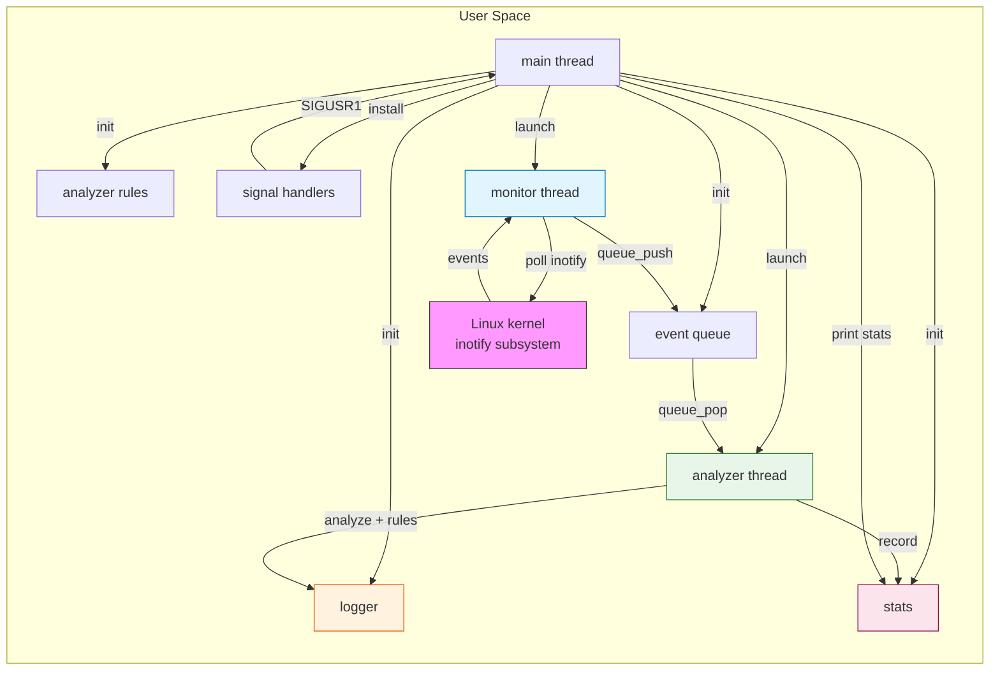

# SecureBox

> Real-time Linux directory surveillance system with anomaly detection  
> *S8 GI Project — ENSA, Academic Year 2025–2026*

[](https://en.cppreference.com/w/c)
[](LICENSE)
[](https://www.linux.org/)
[](#)

SecureBox monitors a local directory in real-time using Linux `inotify`, logs every filesystem event (create, delete, modify, rename), and raises alerts on suspicious behavior patterns such as file deletion bursts, rapid repeated modifications, hidden file creation, forbidden extensions, and unexpected executable files.

---

## Table of Contents

- [Overview](#overview)
- [Key Features](#key-features)
- [Architecture](#architecture)
- [Technology Stack](#technology-stack)
- [Installation & Setup](#installation--setup)
- [Usage](#usage)
- [Signal Reference](#signal-reference)
- [Detection Rules](#detection-rules)
- [Test Scenarios](#test-scenarios)
- [Project Structure](#project-structure)
- [Security Notes](#security-notes)
- [Limitations & Future Work](#limitations--future-work)

---

## Overview

**Problem:** System administrators and security-conscious users need lightweight, real-time visibility into directory activity on Linux machines — without heavy agents or cloud dependencies.

**Solution:** SecureBox is a standalone C CLI tool that leverages the Linux kernel's `inotify` subsystem to watch a directory and produce structured log entries and threshold-based alerts. It runs as two worker threads (monitor + analyzer) connected by a thread-safe event queue, with the main thread handling signals and lifecycle management.

**Target audience:** Linux systems administrators, security students, and developers who need an embeddable filesystem monitoring primitive.

---

## Key Features

| Feature | Description |
|---------|-------------|
| **Real-time monitoring** | Uses `inotify` + `poll()` with 500 ms timeout for responsive event capture |
| **Multi-threaded architecture** | Producer-consumer pattern: monitor thread feeds event queue → analyzer thread processes |
| **Thread-safe logging** | Mutex-protected logger writes to `logs/securebox.log` (file permissions `0640`) |
| **Burst deletion detection** | Alerts when >5 file/directory deletions occur within a 10-second window |
| **Rapid modification detection** | Alerts when the same file is modified >3 times within 5 seconds |
| **Hidden file detection** | Alerts on any file whose basename starts with `.` |
| **Forbidden extension blocking** | Alerts on `.exe`, `.bat`, `.sh`, `.cmd`, `.dll`, `.scr` |
| **Executable bit detection** | Alerts on newly created files with any execute permission bit set |
| **Internal rename tracking** | Reconstructs `IN_MOVED_FROM`/`IN_MOVED_TO` pairs using inotify cookies |
| **Graceful signal handling** | `SIGINT`/`SIGTERM` for clean shutdown; `SIGUSR1` for runtime stats without interrupting |
| **Memory leak free** | Clean valgrind profile; `make memcheck` target included |

---

## Architecture



**Thread model:**

| Thread | Role | Key syscalls |
|--------|------|-------------|
| `main` | Lifecycle orchestration, signal consumption loop | `pthread_create`, `pthread_join`, `nanosleep` |
| `monitor` (producer) | `inotify_init1` → `inotify_add_watch` → `poll()` → `read()` → push to queue | `inotify_init1`, `inotify_add_watch`, `poll`, `read`, `close` |
| `analyzer` (consumer) | Pop queue → apply 5 detection rules → log with severity → update counters | `queue_pop`, `lstat`, `snprintf` |

All shared state (`stats_t`, `event_queue_t`) is protected by pthread mutexes. Signal handlers use only `sig_atomic_t` flags — no async-signal-unsafe functions.

---

## Technology Stack

| Category | Technology |
|----------|-----------|
| **Language** | C11 (`-std=c11`) |
| **Threading** | POSIX pthreads |
| **Filesystem events** | Linux `inotify` (`inotify_init1`, `inotify_add_watch`, `IN_CREATE/DELETE/MODIFY/MOVED_*`) |
| **I/O multiplexing** | `poll()` with 500 ms timeout |
| **Build system** | GNU Make |
| **Logging** | Custom thread-safe logger (`open()` + `fwrite()` + mutex + `fsync`) |
| **Memory safety** | Valgrind-compatible; `make memcheck` target |
| **Compilation flags** | `-Wall -Wextra -Wpedantic -Wshadow` |

---

## Installation & Setup

### Prerequisites

- Linux kernel ≥ 2.6.27 (inotify support)
- `gcc` ≥ 4.6 or any compiler supporting C11
- `make`
- POSIX threads (`libpthread`)

### Build

```bash
# Normal build (optimized)
make

# Debug build (with -g, no optimization — for gdb/valgrind)
make debug

# Release build (O2 optimization)
make release
```

### Memory check

```bash
make memcheck DIR=/path/to/watch
```

Runs valgrind with `--leak-check=full --show-leak-kinds=all`.

---

## Usage

```bash
# Watch a directory
./securebox /path/to/directory

# Example
./securebox /home/user/documents
```

**Console output:**
- `INFO` events → `stdout`
- `ALERTE` events → `stderr`

**Log file:** `logs/securebox.log` (created automatically on first run, permissions `0640`)

**Log format:**
```
[2026-05-14 10:23:45] [INFO]   CREATE_FILE : /home/user/test/data.txt
[2026-05-14 10:23:50] [INFO]   MODIFY_FILE : /home/user/test/report.pdf
[2026-05-14 10:24:01] [ALERTE] DELETE_FILE : /home/user/test/notes.txt
[2026-05-14 10:24:01] [ALERTE] Activite suspecte detectee : 6 suppressions en 10 secondes
```

---

## Signal Reference

| Signal | Effect | Handler type |
|--------|--------|-------------|
| `SIGINT` (Ctrl+C) | Graceful shutdown: close queue, join threads, print final stats | `sigaction` with `on_stop()` |
| `SIGTERM` | Same as `SIGINT` | `sigaction` with `on_stop()` |
| `SIGUSR1` | Print current statistics to stdout without stopping | `sigaction` with `SA_RESTART` |

```bash
# Trigger stats dump while running
kill -USR1 $(pgrep -f securebox)

# Clean shutdown
kill -TERM $(pgrep -f securebox)
# or press Ctrl+C
```

---

## Detection Rules

All thresholds are defined in `config.h` and can be adjusted at compile time.

| Rule | Condition | Alert Message | Constant |
|------|-----------|---------------|----------|
| **Burst deletions** | >5 `DELETE_*` events within 10 s | *"Activite suspecte detectee : N suppressions en 10 secondes"* | `DELETE_THRESHOLD=5`, `DELETE_WINDOW_SEC=10` |
| **Rapid modifications** | >3 `MODIFY_FILE` on same file within 5 s | *"Modifications rapides repetees (N en 5 s) sur <path>"* | `MODIFY_THRESHOLD=3`, `MODIFY_WINDOW_SEC=5` |
| **Hidden file** | Created file basename starts with `.` | *"Creation d'un fichier cache : <path>"* | `utils_is_hidden()` |
| **Forbidden extension** | Created file ends with `.exe/.bat/.sh/.cmd/.dll/.scr` | *"Extension interdite detectee : <path>"* | `FORBIDDEN_EXTENSIONS[]` |
| **Executable bit** | New file has any `S_IXUSR\|S_IXGRP\|S_IXOTH` bit set | *"Apparition d'un fichier executable : <path>"* | `is_executable_file()` |

---

## Test Scenarios

| # | Action | Expected Result |
|---|--------|----------------|
| 1 | Launch with valid directory | Startup message, log file created |
| 2 | Launch with non-existent path | Error message, exit code 1 |
| 3 | `touch data.txt` | `CREATE_FILE` log entry |
| 4 | `echo x >> data.txt` | `MODIFY_FILE` log entry |
| 5 | `rm data.txt` | `DELETE_FILE` log entry |
| 6 | `touch .secret` | `ALERTE` — hidden file detected |
| 7 | `touch malware.exe` | `ALERTE` — forbidden extension |
| 8 | Rapid loop: `rm f{1..6}` in <10 s | `ALERTE` — burst deletion |
| 9 | Press `Ctrl+C` | Clean shutdown + stats summary |
| 10 | `kill -USR1 <pid>` | Stats printed without stopping |

---

## Project Structure

```
securebox/
├── main.c              # Entry point, thread orchestration, graceful shutdown
├── monitor.c           # inotify watcher, poll loop, event translation
├── analyzer.c          # 5 detection rules, sliding-window counters
├── logger.c            # Thread-safe file logger (mutex + fsync)
├── stats.c             # Event counters with mutex protection
├── signals.c           # SIGINT/SIGTERM/SIGUSR1 handlers (sig_atomic_t)
├── utils.c             # Event queue (circular buffer), path helpers
├── config.h            # All thresholds, forbidden extensions, enum types
├── *.h                 # Public headers for each module
├── Makefile            # all / debug / release / memcheck / clean targets
├── README.md           # This file
├── .gitignore          # Excludes .o, binary, logs/
└── logs/
    └── securebox.log   # Created at runtime (gitignored)
```

**Source lines:** 1,366 total across 7 source files + 7 headers.

---

## Security Notes

- No `system()` calls — only POSIX direct syscalls
- Log file created with mode `0640` (owner read/write, group read only)
- All shared structures protected by `pthread_mutex_t`
- Signal handlers use only async-signal-safe functions (`write`, `sig_atomic_t`)
- `SIGPIPE` ignored to prevent unexpected termination
- `inotify_init1(IN_NONBLOCK \| IN_CLOEXEC)` — non-blocking, close-on-exec

---

## Limitations & Future Work

| Limitation | Proposed improvement |
|------------|---------------------|
| Linux-only (`inotify`) | Add macOS (`FSEvents`) and Windows (`ReadDirectoryChangesW`) backends via `#ifdef` |
| Single directory per instance | Support watching multiple directories with a single process |
| Fixed thresholds at compile time | Load rules from a JSON/YAML config file at runtime |
| No network alerting | Send alerts via email, webhook, or syslog |
| No persistent history | Store events in a SQLite database for retrospective analysis |
| No authentication | Require a token to start monitoring sensitive directories |

---

*Developed as part of the S8 Systems Programming (GI) course at ENSA.*
